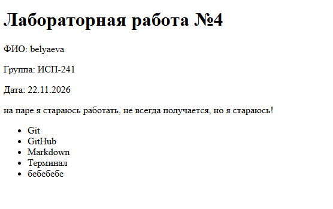
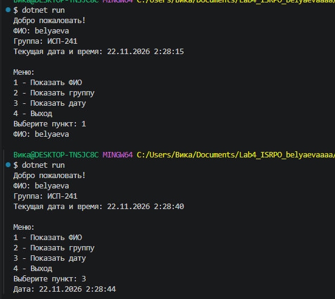
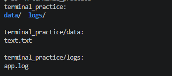
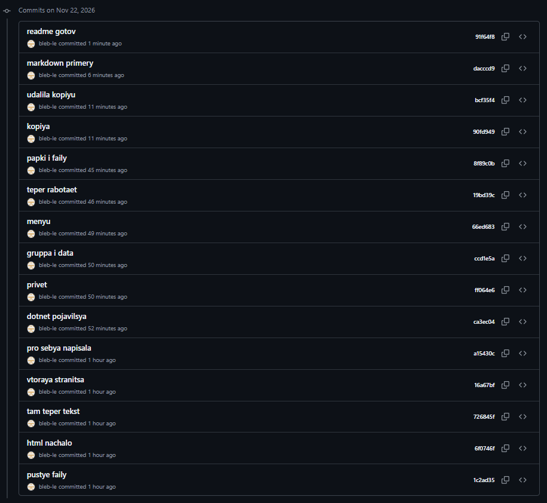

# Лабораторная работа №4. Git, Markdown, терминал и структура проекта

**ФИО:** БЕЛЯЕВА ВИКТОРИЯ ДМИТРИЕВНА
**Группа:** ИСП-241
**Дата:** 22.11.2026(время 3:11!!)

## Описание проекта

Работа закрепляет навыки Git, GitHub, Markdown и терминала! В проекте есть backend на C# и практика работы в терминале...!

## Содержание

- [Описание проекта](#описание-проекта)
- [Структура проекта](#структура-проекта)
- [Примеры Markdown](#примеры-markdown)
- [Пример LaTeX](#пример-latex)
- [Ссылка на репозиторий](#ссылка-на-репозиторий)
- [Скриншоты](#скриншоты)
- [Заключение](#заключение)

## Структура проекта

```text
Lab4_ISRPO_belyaeva/
├── client/
│   ├── index.html
│   └── about.html
├── docs/
│   ├── markdown_examples.md
│   └── latex_examples.md
├── repo/
├── server/
│   └── Program.cs
├── terminal_practice/
│   ├── logs/
│   └── data/
└── README.md
```

## Примеры Markdown

### Заголовок
Это заголовок третьего уровня!!!!

### Список
- Git
- Markdown
- C#

### Картинка


### Код
```csharp
Console.WriteLine("Hello, World!");
```

## Пример LaTeX

Inline: $S = \pi r^2$

$$
\sum_{i=1}^n i = \frac{n(n+1)}{2}
$$

## Ссылка на репозиторий

[Lab4_ISRPO_belyaeva](https://github.com/bleb-le/-Lab4_ISRPO_belyaeva)

## Скриншоты






## Заключение

В ходе работы я закрепила навыки Git (коммиты и push), Markdown и LaTeX, работы в терминале, а также сделала простое приложение на C#.