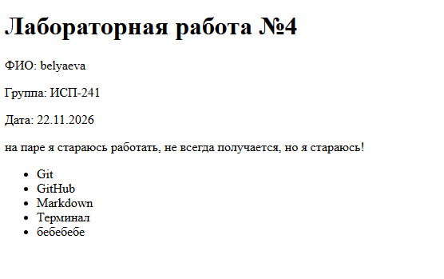

# Примеры Markdown

**ФИО:** belyaeva

**Группа:** ИСП-241

**Дата:** 22.11.2026

---

## Заголовки

# Заголовок H1
## Заголовок H2
### Заголовок H3
#### Заголовок H4
##### Заголовок H5
###### Заголовок H6

---

## Горизонтальные линии

---
***
___

## Форматирование текста

**жирный**, *курсив*, ~~зачёркнутый~~, `моноширинный`

## Списки

Маркированный:
- Пункт 1
- Пункт 2

Нумерованный:
1. Первый
2. Второй

Вложенный:
1. Пункт
    - Подпункт
    - Подпункт

## Цитаты

> Пример цитаты
>> Вложенная цитата

## Блоки кода

```bash
git status
```

## Таблица

| Функция | Команда Git | Описание |
|:--------|:-----------:|---------:|
| Создание репозитория | `git init` | Инициализация |
| Просмотр состояния | `git status` | Показывает изменения |
| Отправка на GitHub | `git push` | Загружает коммиты |

## Картинка



## Ссылки

- Внешняя: [GitHub](https://github.com "Перейти на GitHub")
- Внутренняя: [Перейти к таблице](#таблица)

## Чекбоксы

- [x] Сделано
- [ ] Не сделано

## Alert-блок

> [!NOTE]
> Пример

## LaTeX

Inline: $a^2 + b^2 = c^2$

Block:

$$
\sum_{i=1}^n i = \frac{n(n+1)}{2}
$$